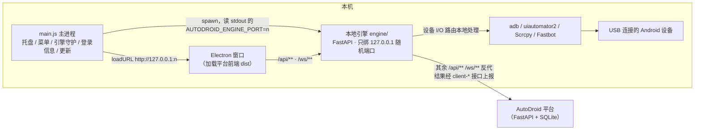

# AutoDroid Desktop

**[AutoDroid](https://github.com/liqiu-debug/AutoDroid)** 自动化测试平台的桌面客户端：Electron 壳 + 本地 Python 引擎网关。
设备操作（adb / uiautomator2 / Scrcpy / Fastbot）全部在本机完成，用例、场景、报告等数据仍在云端平台——
团队成员把手机插在自己电脑上，就能用平台的全部录制与执行能力，不必把设备接到服务器。

> 同一产品的其它端：Web 前端随平台仓库发布；手机端见
> [AutoDroid-Android](https://github.com/liqiu-debug/AutoDroid-Android) 与
> [AutoDroid-iOS](https://github.com/liqiu-debug/AutoDroid-iOS)。
> 桌面端与 Web 端共用**同一份前端构建产物**（`AutoDroid/frontend/dist`），前端通过
> `GET /api/client/info` 是否返回 200 来识别自己运行在客户端模式。

## 目录

- [工作原理](#工作原理)
- [快速开始（开发态）](#快速开始开发态)
- [配置与环境变量](#配置与环境变量)
- [本地引擎做了什么](#本地引擎做了什么)
- [与平台的接口](#与平台的接口)
- [运行行为](#运行行为)
- [测试](#测试)
- [打包与发布](#打包与发布)
- [排障](#排障)
- [已知限制与注意事项](#已知限制与注意事项)
- [目录结构](#目录结构)

## 工作原理



三个关键约定：

1. **引擎只绑 `127.0.0.1`，端口随机。** 主进程 spawn 引擎后解析其 stdout 第一行
   `AUTODROID_ENGINE_PORT=<n>`，再把窗口导航到 `http://127.0.0.1:<n>`。不要在任何地方写死端口。
2. **凭证不落盘。** 平台 token 只存在引擎进程内存里（登录响应中摘出，供心跳/登出使用）；
   「保存登录信息」里的密码由主进程用 Electron `safeStorage` 加密后写入 `userData/logins.json`，
   明文从不写盘，preload 不接触文件系统。
3. **`engine/core/` 是平台后端的 vendor 拷贝。** 驱动、步骤契约、错误码、投屏、Fastbot 等模块
   直接来自 `AutoDroid/backend/`，每个文件头部标注来源与剥离点。改这些文件前先看
   [已知限制](#已知限制与注意事项)。

## 快速开始（开发态）

### 前置条件

| 依赖 | 版本 | 说明 |
|---|---|---|
| Node.js | 20+ | 壳与 electron-builder |
| Python | 3.11+（CI 使用 3.12） | 本地引擎；开发态直接 `python -m engine` |
| 平台仓库 | `AutoDroid` 与本仓库**并排放置** | 引擎默认从 `../AutoDroid/frontend/dist` 托管前端 |
| adb | 可选 | 不装也行：`scripts/fetch-platform-tools.sh` 可内置 Google 官方 platform-tools |

目录形态：

```text
<任意目录>/
├── AutoDroid/            # 平台仓库（含 frontend/）
└── AutoDroid-Desktop/    # 本仓库
```

### 步骤

```bash
# 1. 构建一次平台前端（桌面端直接托管这份 dist）
cd AutoDroid/frontend && npm install && npm run build

# 2. 本仓库：Python 引擎依赖 + 壳依赖
cd ../../AutoDroid-Desktop
python3 -m venv .venv && .venv/bin/pip install -r requirements-dev.txt
npm install

# 3.（可选）内置 adb，避免依赖机器上的 Android SDK
bash scripts/fetch-platform-tools.sh darwin      # Windows 用 windows，两者都要用 all

# 4. 启动
npm start
```

启动后先出现深色加载页（"正在启动本地引擎…"），引擎就绪后自动切到平台登录页。
在登录页填**平台地址**（如 `http://192.168.1.10:8000` 或 `https://你的域名`）、账号、密码即可；
地址会被归一化后写入 `userData/config.json`，下次自动带出。

开发态没有 `release-engine/` 时，主进程回退执行 `python3 -m engine`（Windows 为 `python`），
可用 `AUTODROID_PYTHON` 指定解释器。要用打包后的引擎本地验证，先跑 `npm run dist:engine`。

## 配置与环境变量

### 环境变量

| 变量 | 读取方 | 默认值 | 作用 |
|---|---|---|---|
| `AUTODROID_PYTHON` | 主进程 | `python3` / `python` | 开发态回退启动引擎用的解释器 |
| `AUTODROID_ENGINE_PORT` | 引擎 | 随机 | 指定引擎监听端口（调试用） |
| `AUTODROID_FRONTEND_DIST` | 引擎 | 打包态 `resources/frontend-dist`；开发态 `../AutoDroid/frontend/dist` | 前端静态产物目录 |
| `AUTODROID_USER_DATA` | 引擎 | Electron `userData`；独立运行引擎时 `~/.autodroid-desktop` | 配置、模板缓存等运行时数据根目录（由主进程注入） |
| `AUTODROID_ENGINE_ASSETS_DIR` | 引擎 | 打包态 `resources/assets` | Fastbot jar、`scrcpy-server.jar` 所在目录（不打进引擎二进制） |
| `AUTODROID_ADB` | 引擎 | 内置 platform-tools 存在时由主进程注入 | adb 可执行路径，解析链最高优先级 |
| `ADBUTILS_ADB_PATH` | adbutils / uiautomator2 | 由引擎按解析结果注入 | 保证"一个 adb 管到底" |
| `AUTODROID_ENGINE_LOG_LEVEL` | 引擎 | `INFO` | 引擎日志级别 |
| `AUTODROID_HEARTBEAT_INTERVAL` | 引擎 | `60`（秒） | 设备心跳周期；云端 3 倍周期未收到即判离线 |
| `AUTODROID_TASK_REFRESH_SECONDS` | 引擎 | `300`（秒，下限 30） | 从云端拉取本机定时任务的刷新周期 |
| `AUTODROID_CLIENT_VERSION` | 引擎 | `package.json` 的 `version` | `GET /api/client/info` 报告的版本号 |

### adb 解析链

引擎所有 adb 调用（subprocess、adbutils、uiautomator2）都走同一个入口 `engine/adb_scan.py::find_adb_path`，顺序为：

显式参数 → `AUTODROID_ADB` → `ADBUTILS_ADB_PATH` → 内置 platform-tools
（打包态 `resources/platform-tools/`，开发态 `assets/platform-tools/<darwin|windows>/`）
→ `PATH` → `ANDROID_HOME` / `ANDROID_SDK_ROOT` → 常见 SDK 安装路径兜底。

### userData 目录里有什么

| 文件 | 内容 |
|---|---|
| `config.json` | `{server, client_instance_id}`——归一化后的平台地址与本机实例标识，**不含任何凭证** |
| `logins.json` | 「保存登录信息」：服务器、用户名、`safeStorage` 加密后的密码密文（base64）、是否自动登录 |
| `updates/` | 应用内更新下载的安装包 |

macOS 下 `userData` 为 `~/Library/Application Support/AutoDroid`，Windows 为 `%APPDATA%\AutoDroid`。

## 本地引擎做了什么

引擎是一个 FastAPI 应用（`engine/app.py`），对前端表现为"就是平台"，但按路径分三类处理：

**1. 客户端专属路由（引擎自己实现）**

| 路由 | 作用 |
|---|---|
| `GET /api/client/info` | 返回 `{clientMode: true, platform, version}`；云端平台没有这个路由，前端据此切换客户端模式 |
| `POST /api/auth/token` | 读请求头 `X-AutoDroid-Server`，归一化后记为 upstream，再把登录转发给平台；成功后在内存登记 token |
| `POST /api/devices/sync` | 本机 adb 扫描 → `POST {平台}/api/client-devices/register` 注册为本客户端的设备 → 回源 `/api/devices/` |

**2. 设备 I/O 与本地执行路由（`engine/local_api.py` 拦截，不反代）**

这些路由的请求/响应形状与平台对应端点逐一对齐，前端无需感知差别：

| 类别 | 路由 |
|---|---|
| 录制 | `GET /api/device/dump`、`POST /api/device/inspect`、`POST /api/device/interact`、`POST /api/device/execute_step`、`POST /api/device/crop_template`（模板裁剪后上传 `client-templates`） |
| 用例执行 | `POST /api/cases/{id}/run`、`POST /api/cases/{id}/run-batch`、`GET /api/cases/{id}/precheck`、`WS /ws/run/{case_id}` |
| 场景执行 | `POST /api/scenarios/{id}/run`、`GET /api/scenarios/{id}/precheck`、`WS /api/scenarios/ws/run/{id}` |
| 运行控制 | `GET /api/runs/active`、`POST /api/runs/cancel` |
| 安装包 | `POST /api/packages/{id}/install`（从平台下载到本地后 `adb install`） |
| Fastbot | `POST /api/fastbot/run`（本地轻量档采集：Monkey + logcat + 性能采样 + 崩溃异常回放；结果与回放产物上报 `client-fastbot`） |
| 截图 | `GET /api/devices/{serial}/screenshot` |
| iOS 投屏 | `GET /api/stream/ios-mjpeg/{serial}`、`WS /ws/ios-mjpeg/{serial}`：**显式降级**（WS 关闭码 4000 并给出原因），桌面端当前不提供 iOS 实时画面 |

**3. 其余全部反代到平台**

`/api/**` 走 httpx 流式透传（不缓冲请求/响应体，剥离 hop-by-hop 头，`Authorization`/`Cookie` 原样转发，
普通 API 短超时、流式/上传长超时，客户端断连即取消上游请求）；`/ws/**` 双向透传消息。
不匹配任何 API 的路径托管前端 dist，并做 SPA fallback；`index.html` 永不缓存（与平台 `spa.py` 同策略）。

**后台任务**

- **心跳**：登录后每 60 秒 `POST /api/client-devices/heartbeat`，退出登录时 `POST .../logout` 把设备置离线。
- **定时任务**：`engine/core/task_scheduler.py` 每 300 秒拉取云端分配给本客户端的任务，用 APScheduler 在本机到点触发，语义对齐平台 `scheduler_service`。

## 与平台的接口

桌面端依赖平台 `main` 分支已包含的"客户端"接口（`backend/api/client_*.py` 与 `backend/version_lock.py`）：

| 平台接口 | 用途 |
|---|---|
| `POST /api/client-devices/register` · `heartbeat` · `logout` | 设备归属到登录用户（`owner_id`）、在线状态 |
| `POST /api/client-runs/` · `/{run_ref}/steps` · `/{run_ref}/finish` | 本地执行的步骤结果与最终报告上报 |
| `POST /api/client-templates` | 录制时裁出的图像模板上传 |
| `POST /api/client-fastbot` | Fastbot 采集结果上报 |
| `GET /api/client-tasks` | 下发归属本客户端的定时任务（引擎每 300 秒拉取，本地到点触发） |
| `version_lock`（原子 CAS） | 用例/场景并发编辑的乐观锁 |

平台版本过旧（没有这些路由）时，登录可以成功，但设备同步与结果上报会失败。

**前端桥（`window.desktop`）**，由 `preload.js` 经 `contextBridge` 暴露，前端在对象缺失时降级为纯 Web 行为：

| 方法 | 作用 |
|---|---|
| `getClientInfo()` | `{platform, version}`，前端据 `platform` 选择更新包（`darwin`→macos、`win32`→windows） |
| `getSavedLogin()` / `saveLogin(data)` / `markLoggedOut()` | 登录信息的读 / 写 / 标记已登出 |
| `installUpdate({url, fileName, version})` | 下载更新包到 `userData/updates/` 并拉起安装器；只接受 http(s) URL |
| `onUpdateProgress(cb)` / `onCheckUpdateRequest(cb)` | 订阅下载进度、托盘"检查更新"请求；返回退订函数 |

应用内更新的更新源是**平台的 App 包管理**，与 Android 客户端走同一通道：前端按平台选条目，壳负责下载与拉起安装器。

## 运行行为

- **单实例**：重复启动只会把已有窗口拉到前台。
- **托盘常驻**：关闭窗口只是隐藏，托盘菜单提供"显示主窗口 / 检查更新 / 退出"；真正退出走托盘"退出"或 Cmd/Ctrl+Q，退出时同步结束引擎进程。
- **重新加载逃生口**：菜单"视图 → 重新加载"、Cmd/Ctrl+R、右键菜单三处都能刷新页面。页面有未保存修改（`beforeunload`）时弹原生确认框，而不是静默吞掉刷新。
- **引擎自愈**：引擎意外退出后按 1s → 2s → 4s … 封顶 30s 的指数退避自动重启并重载窗口，最多 6 次；稳定运行 30 秒后重试计数清零。超过上限才弹"本地引擎已退出"对话框。
- **外链**：`setWindowOpenHandler` 把 http(s) 新窗口交给系统浏览器，其余拒绝。
- **窗口**：默认 1440×900，最小 1024×700。

## 测试

```bash
npm run check           # 五个壳文件的 node --check 语法检查
npm run check:bridge    # electron 跑 tests/electron_bridge_check.js：桥接 / 策略纯函数 / IPC 接线自检
npm run test:engine     # pytest tests/：引擎单元与契约测试（网关、反代、本地 API、各 service、adb 路径、登录存储…）
npm run test:smoke      # 真起引擎进程做端到端：client/info → 登录归一化 → 静态托管 → mock 上游全链路；再跑 WS 反代往返
```

`tests/smoke_mock_upstream.py` 用一个假平台验证 登录 → 设备注册 → 心跳 → `client-runs` 上报 → 登出 的完整契约，
不需要真实平台和真机。

> 目前仓库的 GitHub Actions（`build-windows.yml`）只负责出 Windows 安装包，**不运行以上测试**，提交前请在本机跑一遍。

## 打包与发布

### 原则

- 引擎用 PyInstaller **onedir** 打包（`engine.spec`，冷启动 1–2 秒；onefile 实测 28 秒已弃用），产物 `release-engine/autodroid-engine/`。
- PyInstaller **不能跨平台**：Windows 引擎必须在 Windows 上构建，macOS 引擎在 macOS 上构建。
- 三类前置产物缺一不可，`scripts/check-dist-prereqs.sh` 在 `npm run dist*` 之前硬校验，缺件直接失败（electron-builder 对缺失的 `extraResources` 只告警不报错，否则会打出没有引擎 / 没有 UI / 没有 adb 的"死包"）：
  1. 前端 `../AutoDroid/frontend/dist/index.html`
  2. 引擎 `release-engine/autodroid-engine[.exe]`
  3. 内置 adb `assets/platform-tools/<darwin|windows>/adb[.exe]`
- Fastbot jar 与 `scrcpy-server.jar`（`assets/`）和 platform-tools 作为 `extraResources` 放在 asar 外，按目标平台分目录，绝不混装对方平台的二进制。

### macOS

```bash
bash scripts/build-mac.sh
```

依次：内置 darwin platform-tools（已存在跳过）→ 构建引擎（`release-engine/` 已存在跳过，删目录可强制重建）→ 前端 dist（已存在跳过）→ `npm run dist:mac`。
产物在 `release/`：`AutoDroid-<版本>-<arch>.dmg` 与 `.zip`（x64 + arm64）。

### Windows

本机构建（PowerShell，仓库目录下）：

```powershell
powershell -ExecutionPolicy Bypass -File .\build-windows.ps1
```

脚本自动完成 platform-tools 下载 → `.venv` + PyInstaller 引擎 → 前端 dist（缺失时自动 `npm run build`）→ NSIS 安装包，产物 `release\AutoDroid Setup <版本>.exe`。

没有 Windows 机器时用 GitHub Actions：`.github/workflows/build-windows.yml` 在 `windows-latest` 上同时 checkout 本仓库与平台仓库，执行同一脚本，产物挂在 Actions 的 `AutoDroid-Windows-Setup` artifact。触发方式是手动 `workflow_dispatch` 或推送 `v*` tag。

### 版本与更新

- 版本号只改 `package.json` 的 `version`，`GET /api/client/info` 与前端更新检查都以它为准。
- 发布到团队：把 dmg / exe 上传到平台的 **App 包管理**，桌面端托盘"检查更新"即可看到并一键安装。

## 排障

| 现象 | 原因与处理 |
|---|---|
| 启动卡在加载页，随后提示"引擎启动超时（30s 内未输出 AUTODROID_ENGINE_PORT）" | 引擎没起来。开发态终端看 `[engine]` 前缀的 stderr；常见是 `pip install -r requirements.txt` 没装全，或 `AUTODROID_PYTHON` 指错解释器 |
| "引擎进程提前退出（code=…）" | 同上；打包态表示内置引擎自身崩溃，用 `AUTODROID_ENGINE_LOG_LEVEL=DEBUG` 从终端启动应用看完整输出 |
| 窗口白屏 / 404 | 前端 dist 缺失：先构建 `AutoDroid/frontend`，或用 `AUTODROID_FRONTEND_DIST` 指向正确目录 |
| 设备中心看不到手机 | 引擎找不到 adb：`bash scripts/fetch-platform-tools.sh <平台>` 内置一份，或确认 `adb devices` 在终端可用并已授权 USB 调试 |
| 登录成功但"设备同步失败 / 上报失败" | 平台版本不含 `client-*` 路由，升级平台到 `main` |
| 填了地址提示"请输入有效的平台地址" | 地址必须以 `http://` 或 `https://` 开头，不能带用户名密码、`?query`、`#fragment`；末尾的 `/` 与 `/api` 会被自动去掉 |
| Windows 下多出一个黑色控制台窗口 | 当前 `engine.spec` 为 `console=True`，属已知项；关掉它会连带杀掉引擎，请忽略 |
| 页面卡住点不动 | Cmd/Ctrl+R 或菜单"视图 → 重新加载"；如有未保存修改会弹确认 |
| 日志在哪 | 壳与引擎都写 stderr：`[shell]` 为主进程，`[engine]` 为引擎转发输出。从终端启动可见；打包态 macOS 可 `open -a AutoDroid --stderr /tmp/autodroid.log` |

## 已知限制与注意事项

- **iOS**：引擎的 iOS 驱动模块已 vendor，但 `facebook-wda` 未列入 `requirements.txt`（注释掉），且 iOS MJPEG 投屏被显式降级。桌面端当前以 Android 为主；要启用 iOS 执行需自行安装 `facebook-wda` 并自行验证。
- **未签名**：`package.json` 的 `mac` / `win` 段没有配置代码签名与公证，macOS 首次打开需在"隐私与安全性"里放行，Windows 会有 SmartScreen 提示。
- **本地引擎端点不鉴权**：引擎只监听 `127.0.0.1` 随机端口，但端点本身没有认证，`engine/app.py` 对此有注释。可信开发机上可接受，不要把端口映射出去。
- **`engine/core/` 是 vendor 拷贝，不是依赖**：53 个文件、约 1.9 万行来自 `AutoDroid/backend/`，每个文件头形如
  `# 来源：AutoDroid backend/step_contract.py（vendor）。剥离点：……`。平台侧改了 `drivers/`、`device_stream/`、`step_contract.py`、`execution_errors.py` 等共享模块时，**必须同步搬到这里**，否则同一份用例在桌面与平台上会按不同规则执行。同步前先 `diff` 对应文件、只保留文件头注明的剥离点差异。
- **更新包不校验**：`installUpdate` 只校验 URL 为 http(s)、文件名不含路径分隔符，不做哈希/签名/版本比较。更新源是自家平台的 App 包管理，内部使用可接受，对外分发前需补齐。
- **CI 不跑测试**：见[测试](#测试)。

更完整的问题清单与优先级见平台仓库 `docs/APP_AND_CLIENT_REVIEW_2026-10-30.md`。

## 目录结构

```text
AutoDroid-Desktop/
├── main.js                 # Electron 主进程：窗口/托盘/菜单、引擎 spawn 与自愈重启、退出清理
├── preload.js              # contextBridge：window.desktop 桥（登录信息、更新、客户端信息）
├── login_store.js          # 登录信息读写（safeStorage 加密密码）与对应 IPC
├── updater.js              # 应用内更新：下载到 userData/updates 并拉起安装器
├── shell_policies.js       # 壳策略纯函数（重载快捷键、unload 确认、引擎重启退避、exit 分流、内置 adb 注入）
├── engine/
│   ├── __main__.py         # python -m engine 入口：绑 127.0.0.1、打印 AUTODROID_ENGINE_PORT
│   ├── app.py              # FastAPI 网关：client/info、登录转发、设备同步、反代、静态托管
│   ├── local_api.py        # 本地设备 I/O 与本地执行路由（形状对齐平台端点）
│   ├── proxy.py / ws_proxy.py   # HTTP / WebSocket 流式反代
│   ├── presence.py         # 心跳与登出（token 仅内存）
│   ├── config_store.py     # userData/config.json（只存非敏感字段）
│   ├── server_address.py   # 平台地址归一化（与 Android ServerAddress.kt 语义一致）
│   ├── adb_scan.py         # adb 路径解析链与设备扫描
│   └── core/               # ← 自 AutoDroid/backend vendor：drivers、device_stream、fastbot、step_contract、execution_errors、各 service…
├── engine_entry.py         # PyInstaller 入口（等价 python -m engine）
├── engine.spec             # PyInstaller onedir 配置
├── assets/                 # 图标、tray.png、fastbot jar、scrcpy-server.jar；platform-tools/ 由脚本下载且不入库
├── scripts/
│   ├── build-mac.sh            # macOS 一键出包
│   ├── fetch-platform-tools.sh # 下载 Google platform-tools 到 assets/platform-tools/<平台>/
│   └── check-dist-prereqs.sh   # 出包前置硬校验
├── build-windows.ps1       # Windows 一键出包
├── tests/                  # pytest 单测 + electron 桥自检 + smoke 脚本
├── .github/workflows/build-windows.yml   # Windows 安装包 CI（tag / 手动）
├── requirements.txt / requirements-dev.txt
└── package.json            # 版本号、npm scripts、electron-builder 配置
```

`release/`、`release-engine/`、`build-engine/`、`assets/platform-tools/`、`.venv/`、`node_modules/` 均为生成物，已 gitignore。
